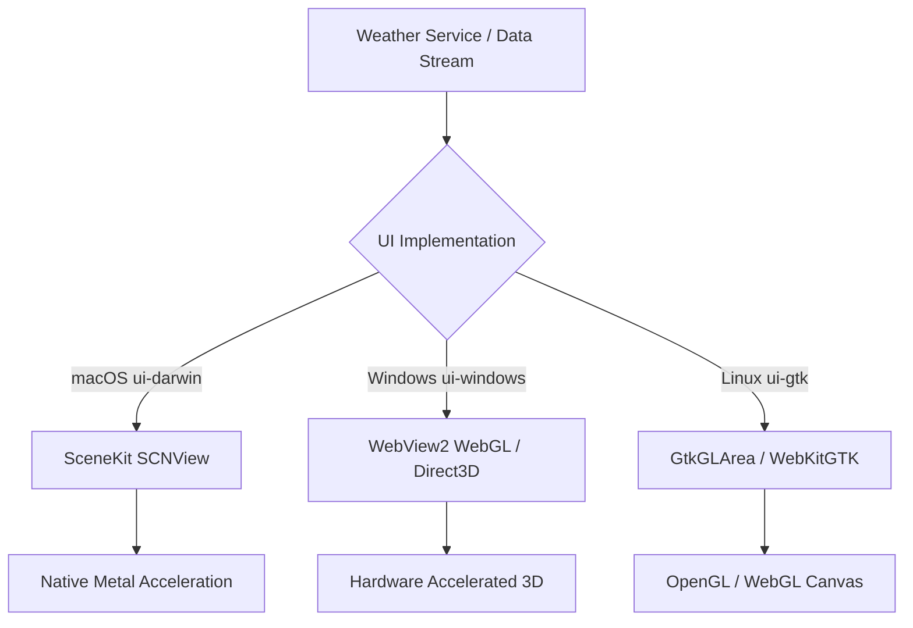
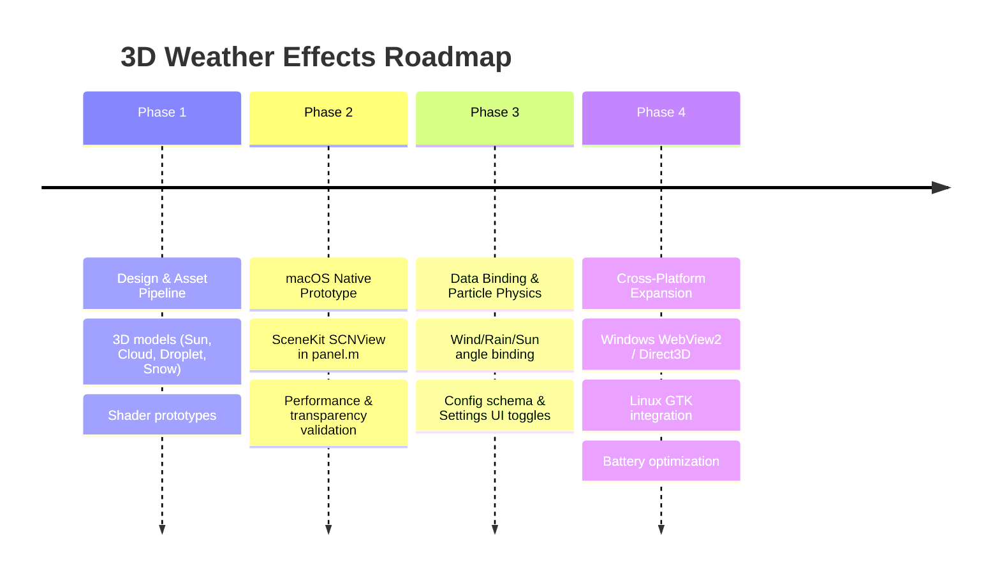

# 3D Weather Effects & Display — Future Release Architecture & Concept

> **Status:** Future Release Proposal / Exploration  
> **Target Version:** Post-v2.3.0  
> **Related Design Docs:** [weather-widget-design.md](weather-widget-design.md), [POLLUTION_TICKER.md](POLLUTION_TICKER.md)

---

## 1. Overview & Vision

WeatherWidget currently renders clean, modern 2D desktop overlay cards in two layouts: **Enhanced View** (horizontal metrics grid, day/night image backgrounds) and **Simple View** (compact vertical layout). 

This document captures the design, visual concepts, and technical implementation options for introducing an **optional, eye-candy 3D weather display**. Users will be able to enable or disable these 3D effects in the Settings panel based on their preference, hardware capabilities, and battery considerations.

### Core Objectives
1. **Visual Delight ("Eye Candy"):** Elevate the desktop experience with immersive, depth-based atmospheric visuals (sun flares, volumetric cloud clusters, drifting snow, falling rain splashes, lightning flickers).
2. **Weather-Driven Procedural Realism:** Directly bind the 3D scene parameters to live atmospheric data (`IconCode`, wind speed/direction, local time, sun angle, temperature, precipitation rate, and AQI).
3. **Flexible Presentation Modes:** Support three visual models:
   - **Pop-Out:** 3D hero elements breaking the frame and floating outside/above the 2D card.
   - **On-Top / Ambient Overlay:** Atmospheric depth layers embedded directly inside the existing card footprint.
   - **Replace / 3D Mode:** A brand-new view mode (alongside Enhanced and Simple) rendering a complete 3D miniature diorama or glass weather globe.
4. **Desktop Efficiency:** Zero or near-zero GPU/CPU overhead when idle or on battery power, with auto-pause during sleep and frame rate capping.

---

## 2. Visual Presentation Concepts

```
┌────────────────────────────────────────────────────────────────────────┐
│                        CONCEPT 1: POP-OUT / HERO                       │
│                                                                        │
│        ☁️ [3D Volumetric Cloud & Rain]  (Floats outside card bounds)   │
│       ╭──────────────────────────────────────────╮                     │
│       │ 📍 London, UK                  12:30:45  │                     │
│       │ 18°C  •  Cloudy with Light Rain          │                     │
│       │ [Metrics Grid...]                        │                     │
│       ╰──────────────────────────────────────────╯                     │
├────────────────────────────────────────────────────────────────────────┤
│                        CONCEPT 2: AMBIENT OVERLAY                      │
│                                                                        │
│       ╭──────────────────────────────────────────╮                     │
│       │ 📍 London, UK                  12:30:45  │                     │
│       │ [3D Weather Viewport] │ [Metrics Grid]   │                     │
│       │ (Rotating sun/flares) │                  │                     │
│       ╰──────────────────────────────────────────╯                     │
├────────────────────────────────────────────────────────────────────────┤
│                        CONCEPT 3: FULL 3D DIORAMA                      │
│                                                                        │
│       ╭──────────────────────────────────────────╮                     │
│       │       🔮 [3D Glass Weather Globe /       │                     │
│       │           Floating Island Diorama]       │                     │
│       │            London  •  18°C  •  12:30     │                     │
│       ╰──────────────────────────────────────────╯                     │
└────────────────────────────────────────────────────────────────────────┘
```

### Concept 1: "Pop-Out" (Frame-Breaking 3D Accent)
* **Description:** The classic 2D card (Enhanced or Simple) remains the main informational surface, but a specialized 3D hero element floats **partially outside the card boundaries**, casting soft contact shadows onto the card top.
* **Behaviors**:
  * **Clear Sky / Sun:** A glowing, slowly rotating 3D sun with radiant volumetric corona rays hovers over the top-left corner.
  * **Rain / Thunderstorm:** A dark or silver stylized 3D cloud floats above the card. 3D rain streaks fall downwards across the card surface, with subtle splash particles rippling on the card ledge.
  * **Snow:** 3D snowflake geometries tumble gently downward with aerodynamic sway and accumulate as light frost along the card border.
* **Window Canvas Sizing:** Requires adding 30–50px of transparent padding around the native desktop window frame so the 3D meshes can break the frame without being clipped by the OS window rect.

### Concept 2: "On-Top" (Atmospheric Ambient Glass Overlay)
* **Description:** The 3D elements stay strictly within the existing card footprint.
* **Behaviors**:
  * **Option 2A (3D Icon Replacement):** The standard 2D weather PNG icon is replaced with a real-time, interactive 3D viewport (e.g. spinning miniature sun, volumetric puffy clouds, floating weather crystal).
  * **Option 2B (Full Card Depth Shader):** The card background transforms from a static image (`day.jpg` / `night.jpg`) into a deep, multi-layered 3D skybox with volumetric fog, drifting cloud layers, and rain streaks that respond to mouse hover with subtle parallax.

### Concept 3: "Replace Current" (Dedicated 3D View Mode)
* **Description:** Introduces a third view mode in addition to `enhanced` and `simple`: **`3d`** ("Diorama" or "Globe").
* **Sub-variants**:
  * **The 3D Weather Globe:** Each city is represented by a translucent glass dome/sphere resting on the desktop. The miniature weather plays out inside the globe (snow globe or thunderstorm orb), with crisp 3D or frosted floating typography displaying the city name, temperature, and local time.
  * **Floating Isometric Diorama:** A stylized floating 3D island/tile per city (e.g., wet reflective asphalt with puddles for rain, lush green terrain with sunlight for clear weather, snow-capped roof for sub-zero temperatures).

---

## 3. Data-Driven Weather Binding

The 3D scene parameters are driven directly by the `WeatherData` struct in `internal/weather/types.go`:

| Atmospheric Metric | Source Field | 3D Visual Parameter & Particle Physics |
| :--- | :--- | :--- |
| **Weather Condition** | `IconCode` (`clear`, `rain`, `snow`, `storm`, `fog`, etc.) | Activates specific 3D geometries and particle systems: volumetric cloud clusters, sun corona, falling rain lines, tumbling snowflake meshes, lightning point-lights. |
| **Local Time & Sun Position** | `LocalTime`, `Sunrise`, `Sunset` | Dynamic scene lighting direction and color temperature: warm amber sunrise/sunset, crisp white midday specular highlights, cool blue moonlight with star field at night. |
| **Wind Speed & Direction** | `WindSpeed`, `WindDirection` | Controls particle drift angle, rain streak tilt, cloud velocity, and turbulence forces. |
| **Temperature & Apparent Temp** | `Temperature`, `FeelsLike` | Atmospheric tint: cold cyan/frost edging on sub-zero days (< 0°C); warm golden ambient bounce or subtle heat-shimmer shader during heatwaves (> 30°C). |
| **Precipitation Intensity** | `PrecipRate`, `Forecast.TodayPrecipSumMM` | Dynamically throttles particle birth rate: light drizzle (low count, thin streaks) vs torrential downpour (dense particles, heavier splashes). |
| **Cloud Cover** | `Clouds` (%) | Controls density and opacity of volumetric cloud layers. |
| **Air Quality** | `AQI`, `PM25`, `PM10` | Modulates scene depth haze and atmospheric light scattering. |

---

## 4. Technical Architecture & Cross-Platform Feasibility

WeatherWidget uses different native UI layers on each platform. Below are the viable implementation routes for 3D:



### Route A: Platform-Native (SceneKit on macOS, WebView2/D3D on Windows, GtkGLArea on Linux)
* **macOS (`internal/ui-darwin`)**:
  * **Technology:** Apple **SceneKit** (`SCNView` in AppKit / Objective-C).
  * **Feasibility:** Highest. SceneKit is bundled with macOS (`-framework SceneKit`), requires zero extra third-party Go or binary dependencies, supports transparent backgrounds natively, and uses Metal for GPU rendering.
  * **Integration:** Embedded directly as an `NSView` subview in `panel.m` (`WWCityCardView`).
* **Windows (`internal/ui-windows`)**:
  * **Technology:** `WebView2` transparent overlay (Three.js / WebGL) or Direct3D 11 with DirectComposition swapchain.
  * **Feasibility:** High. `go-webview2` is already a project dependency (used for Settings), and WebView2 supports transparent background rendering (`ICoreWebView2Controller::put_DefaultBackgroundColor`).
* **Linux (`internal/ui-gtk`)**:
  * **Technology:** `GtkGLArea` (native OpenGL) or `WebKitGTK`.
  * **Feasibility:** Moderate. Requires checking driver capabilities on Wayland/X11.

### Route B: Unified Cross-Platform WebGL (Three.js / Spline in Transparent Webview)
* **Technology:** WebGL scene authored in Three.js or [Spline 3D](https://spline.design), packaged into embedded assets and hosted in transparent webviews on all platforms (`WKWebView` on macOS, `WebView2` on Windows, `WebKitGTK` on Linux).
* **Pros:** Write once, run everywhere. Identical 3D eye candy and shaders across all operating systems.
* **Cons:** Slightly higher memory footprint (~40–80 MB for webview runtimes) than pure native SceneKit.

### Route C: Pre-Rendered 2.5D Animated Loops (Zero GPU / High Battery Life)
* **Technology:** High-fidelity 3D models pre-rendered in Blender into seamless looping transparent animations (animated WebP, APNG, or spritesheets), composited in code with parallax depth.
* **Pros:** 0% dedicated GPU draw calls, zero 3D engine overhead, instant compatibility with the existing 2D drawing loops across Windows GDI, macOS AppKit, and GTK Cairo.
* **Cons:** Fixed camera angle; no free-form 3D rotation or dynamic geometry distortion.

---

## 5. Configuration & Settings Integration

To preserve user choice and accessibility, 3D effects will be controlled via `internal/config`:

```go
// Proposed extensions in internal/config/types.go:

type Effect3DMode string

const (
    Effect3DDisabled Effect3DMode = "disabled"
    Effect3DOverlay  Effect3DMode = "overlay"  // Concept 2: inside card
    Effect3DPopOut   Effect3DMode = "popout"   // Concept 1: breaking card frame
    Effect3DFull     Effect3DMode = "full"     // Concept 3: full 3D diorama/globe
)

type Config struct {
    // ... existing fields ...
    Enable3DEffects  bool          `json:"enable3dEffects,omitempty"`
    Effect3DMode     Effect3DMode  `json:"effect3dMode,omitempty"`
    Effect3DFPSLimit int           `json:"effect3dFpsLimit,omitempty"` // 30 (battery) or 60 (smooth)
}
```

### Settings UI (Appearance Tab)
* **3D Weather Effects:** Dropdown / Segmented control:
  * `Disabled` (Default on low-power devices)
  * `Subtle Overlay (In-Card)`
  * `Pop-Out Hero (Over Edge)`
  * `Full 3D Diorama Mode`
* **Performance / Battery Saver:**
  * Toggle: *“Pause 3D effects when on battery power”*
  * Toggle: *“Cap 3D framerate at 30 FPS”*

---

## 6. Performance, Battery & Resource Safeguards

Continuous 3D rendering on a 24/7 desktop widget requires strict resource guards:

1. **Occlusion & Visibility Culling:**
   - When the widget window is hidden, minimized, or completely covered by another full-screen window, the render loop drops to **0 FPS (completely paused)**.
2. **Power & Sleep Awareness:**
   - Integrate with `internal/power.ResumeNotifier()`: Suspend render loops immediately when entering sleep/hibernation and resume cleanly on wake.
   - Automatically downscale to static rendering or 15 FPS when the operating system enters Low Power / Battery Saver mode.
3. **Adaptive Framerate:**
   - Dynamic framerate throttling: 60 FPS during active weather transitions or user drag/hover, dropping to 15–30 FPS during steady-state idle.

---

## 7. Phased Implementation Roadmap

When scheduling work for post-v2.3.0 releases:



* **Phase 1: Asset Pipeline & Prototyping**
  - Author low-poly, stylized weather assets (sun with corona, puffy volumetric clouds, rain particle emitters, snow crystals).
  - Test transparent window blending on macOS and Windows.
* **Phase 2: macOS SceneKit Proof-of-Concept**
  - Implement a lightweight `SCNView` prototype in `internal/ui-darwin/panel.m` for the "Pop-Out" or "Icon Viewport" mode.
  - Measure memory baseline and CPU/GPU usage.
* **Phase 3: Settings Integration & Data Binding**
  - Add configuration toggles to `config.Config` and Settings UI (macOS `settings.m`, Windows `web/app.js`, GTK `settings.go`).
  - Connect `WeatherData` live metrics to 3D lighting, wind angles, and particle intensity.
* **Phase 4: Windows & Linux Implementation**
  - Port or wrap the 3D pipeline for Windows (`ui-windows`) via `go-webview2` WebGL or Direct3D swapchain, and Linux (`ui-gtk`).
  - Finalize battery-saver guards and occlusion culling.

